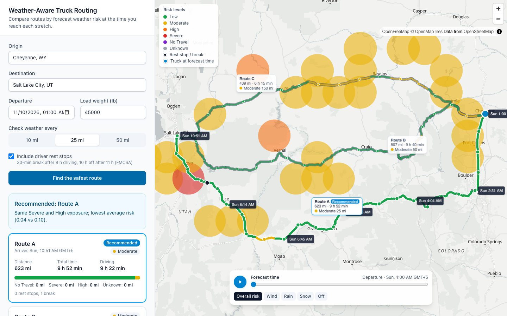
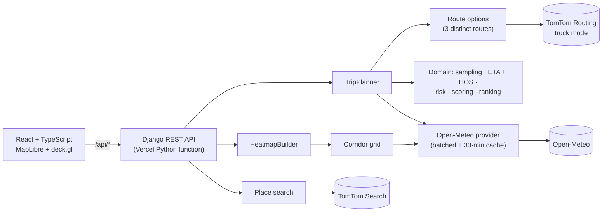

# Weather-Aware Truck Routing

A React + Django web app that helps a truck driver choose the **safest route** based on
**forecast weather at the time the truck reaches each stretch**, the **load weight**, and
**travel time**.

**Live app:** https://weather-awear.vercel.app
&nbsp;·&nbsp; **Walkthrough video:** _Loom link_
&nbsp;·&nbsp; **Spec interpretations:** [docs/assumptions.md](docs/assumptions.md)



_Cheyenne → Salt Lake City with a 45,000 lb load. Each route is labelled with its distance, time
and risk miles. The I-80 routes (B and C) cross more Moderate-risk weather, so Route A is
recommended. The red Severe cell near Provo is the forecast at departure; the truck only reaches
that stretch about 9 hours later, when its forecast is clear._

---

## What it does

1. **Enter** an origin and destination (place search), a departure time, a load weight, and how
   often to check the weather (every 10, 25 or 50 miles).
2. The app gets **three truck routes**, places **checkpoints** along each one, and works out
   **when the truck arrives** at each checkpoint. Arrival times use traffic-aware driving time
   plus federal hours-of-service breaks.
3. Each checkpoint gets the **forecast for that hour** at that place and a **risk level**, using
   the wind, rain and snow thresholds and the load rules.
4. Routes are **ranked**: fewest No Travel, then Severe, then High miles, then lowest average
   risk, then shortest time. The recommendation explains its choice in plain English.
5. The map shows **every route with its checkpoints and risk colours**, a **summary label on each
   route** (distance, time and risk miles; click to select), **arrival times** along the
   selected route and its rest stops, plus a **weather heatmap** along the corridor with a
   **0–48 hour forecast slider**. A truck marker shows where each truck would be at the
   selected hour.

## How the brief's open questions were answered

The brief leaves several rules ambiguous. Each decision below is implemented in pure, unit-tested
domain code and documented in [docs/assumptions.md](docs/assumptions.md). The most important:

| Question | Decision |
|---|---|
| Thresholds touch at the edges (rain 0.25 is in "0.10–0.25" and "0.25–0.50") | Boundary values go to the **higher** level, except the strict "> 1.00" rain and "> 3.0" snow No Travel bounds |
| No Travel isn't in the ranking list | **No Travel miles rank first.** A blocked route never beats a clear one |
| Checkpoints are points, but ranking counts *miles* | Each checkpoint covers the road between the midpoints to its neighbours, so the stretches add up exactly to the route length |
| Missing forecast data | **Unknown, never Low**. Unknown miles count as Severe when ranking |
| When does the truck reach each checkpoint? | From the routing API's traffic-aware time along the route, **plus FMCSA rest breaks** (30 min after 8 h, 10 h after 11 h) |
| Which forecast hour applies? | Precipitation is the total for the hour *ending* after arrival; wind is interpolated between hours |
| Every route crosses No Travel | The least risky route is still shown, with a clear "not advised" warning |
| Load rules | Applied to wind only, and they only escalate (strict `>` 30,000 / 40,000 lb) |

## Architecture



The backend is layered so the logic that's graded can be tested without any network calls:

```
backend/trips/
  domain/     pure logic, no I/O: risk, sampling, eta, hos, scoring, recommend,
              forecast alignment, corridor grid, route overlap, polyline
  providers/  TomTom and Open-Meteo adapters behind protocols; retries, timeouts, cache
  services/   orchestration: route options, trip planning, heatmap frames
  api/        DRF views, validation, JSON presenters, error mapping, rate limits
frontend/src/
  api/        typed client; Zod schemas check every response at runtime
  components/ trip form (accessible combobox), route cards, checkpoint table, time controls
  map/        deck.gl layers (pure, unit-tested) and the MapLibre map
  lib/        geometry, formatting, heatmap frames, truck position
```

### Notable engineering decisions

- **Three routes, reliably.** TomTom often returns only one or two alternatives. Extra
  candidates (via points to either side of the trip, toll or motorway avoidance) are requested
  *at the same time as* the main request. They're kept only if they're genuinely different
  (under 90% overlap) and not an excessive detour, and only fallbacks finishing within a time
  budget are used.
- **An honest heatmap.** Each corridor grid cell is drawn in its exact risk band. A smoothed
  kernel-density heatmap was tried and rejected because it averaged isolated hazardous cells
  away.
- **Smooth scrubbing.** All 49 forecast frames are fetched once and turned into typed arrays.
  Moving the slider makes no network requests and doesn't re-render the route list, and only
  the heatmap and truck layers are rebuilt. **Measured at 60 fps, with no long tasks.**
- **Within free API limits.** Each forecast location costs one weather call, so a trip uses at
  most 200 locations and a heatmap at most 150. Forecasts are cached for 30 minutes and shared
  between plans and heatmaps.
- **Secrets stay server-side.** The TomTom key never reaches the browser, and HTTP client
  logging is locked down so the key can't leak into logs.

## API

| Endpoint | Purpose |
|---|---|
| `GET /api/geocode?q=Denver` | Place suggestions (US and Canada) |
| `POST /api/trips/plan` | Ranked routes with checkpoints, rest stops, risk and the recommendation |
| `POST /api/trips/heatmap` | Corridor grid plus 49 hourly frames of risk and per-factor scores |
| `GET /api/health` | Health check |

```bash
# Departure must be between now and 7 days ahead; this example departs in 2 hours (GNU or BSD date).
DEPART=$(date -u -d '+2 hours' +%Y-%m-%dT%H:%M:%SZ 2>/dev/null || date -u -v+2H +%Y-%m-%dT%H:%M:%SZ)
curl -X POST https://weather-awear.vercel.app/api/trips/plan \
  -H 'Content-Type: application/json' \
  -d '{"origin": {"lat": 32.78, "lon": -96.80}, "destination": {"lat": 29.76, "lon": -95.37},
       "departure_time": "'"$DEPART"'", "load_weight_lb": 42000,
       "sample_interval_mi": 25, "hours_of_service": true}'
```

Errors are always JSON: `400` validation (per field), `422` no truck route, `429` too many
requests, `502`/`503` when a provider fails or is rate-limiting.

## Run it locally

Requirements: Python 3.12 with [uv](https://docs.astral.sh/uv/), Node 22+, and a free
[TomTom API key](https://developer.tomtom.com/).

```bash
make install                              # backend + frontend dependencies, git hooks
cp backend/.env.example backend/.env      # then set TOMTOM_API_KEY and DJANGO_DEBUG=true
make dev                                  # API on :8000, app on http://localhost:5173
```

## Quality gates

```bash
make check    # everything below, as run by the pre-commit hook and CI
```

| | Tooling | Status |
|---|---|---|
| Backend | ruff, `mypy --strict`, pytest (warnings fail the build) | **359 tests, 100% statement + branch coverage** (95% minimum enforced) |
| Frontend | oxlint, Prettier, `tsc` strict, Vitest + Testing Library | **138 tests** |
| Real browser | Headless Chromium on the production build | Desktop + mobile layouts, 0 console errors, 60 fps scrubbing |

Every commit passes `make check`, and CI runs the same steps on each pull request. The work was
delivered in a series of reviewed pull requests (foundation, domain logic, API, frontend,
heatmap, hardening, delivery), each made of small Conventional Commits.

## Deployment

One Vercel project using **Vercel Services**: the Vite build is served as static files, and
Django runs as a Python function under `/api/*` on the same domain, so no CORS is needed. Pushes
to `main` deploy to production, and pull requests get preview deployments. Required environment
variables: `DJANGO_SECRET_KEY`, `TOMTOM_API_KEY`, `DJANGO_NUM_PROXIES=1`.

## Known limitations

- **Free-tier APIs.** Open-Meteo allows 600 calls a minute and 10,000 a day, and each forecast
  location is assumed to count as one call. Heavy simultaneous use can hit the limit; the app
  then says to try again in a minute.
- **Times are shown in the viewer's time zone** (with its abbreviation), not each checkpoint's
  local time.
- **Hours of service** covers the 8-hour break and 11-hour driving limit only, not the 14-hour
  window or weekly limits.
- **Sustained wind** is classified, as in the brief's table. Gusts are shown, with a warning at
  45 mph or more.
- **TomTom's alternatives vary between calls.** Rarely, only two distinct routes exist, and the
  app says so.
